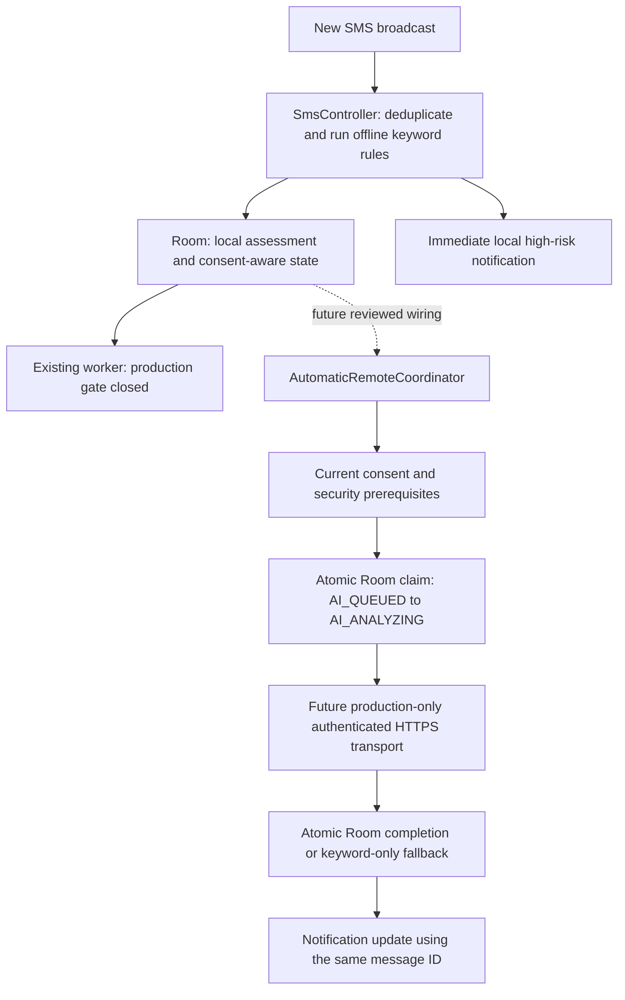

# Phase 3K: Automatic remote analysis foundation

This phase prepares state transitions and tests. **No real SMS is transmitted automatically.** `RemoteTransportGate.PRODUCTION_READY` is still `false`; the live `SmsReceiver` and `SmsProcessingWorker` do not construct the new coordinator. The existing Secure Pilot Test remains a debug-only, manually entered **synthetic** path.

## Architecture



The current receiver invokes local keyword detection before considering a worker. Zero local keyword matches remain `UNVERIFIED` when remote analysis is not completed. Historical imports are excluded by the existing intake policy and again by the new coordinator. Research contribution consent is separate and was not modified.

The new `AutomaticRemoteCoordinator` accepts an injectable transport solely so synthetic tests can exercise outcomes. Its default authorization uses the still-closed production gate. It checks consent generation and transport requirements immediately before a request and again after a response. It attempts no automatic retry. A timeout, revoked credential, network error, or malformed AI result moves a claimed item to `REMOTE_UNAVAILABLE`, retaining the local warning or `UNVERIFIED`. Revocation during work moves it to `REMOTE_CONSENT_DISABLED` without applying an AI verdict. Cancellation is propagated after updating the local state. Candidate and verified-result diagnostic strings omit SMS text and rationale.

`MessageDao` claims queued work with a conditional SQL update; a second worker gets zero rows and cannot send. A verified result is also committed by conditional update only from `AI_ANALYZING`. `SmsController.applyRemoteResult` posts or updates a notification only after that commit succeeds. Local and remote alerts share the message ID and `NotificationHelper` uses `setOnlyAlertOnce`, avoiding another audible alert for an update. A remote SAFE result cancels an existing local warning. The device-side Room instrumentation tests cover these conditional transitions with synthetic rows.

The test suite reuses `PilotSmsClient` **only for synthetic fixtures** against OkHttp MockWebServer. A test-only interceptor redirects the approved HTTPS request to loopback HTTP inside the test process. This checks bearer authentication and the existing pilot request/response contract. It does not enable real-message use of the pilot endpoint or weaken the production TLS policy. A separate production transport and backend endpoint are intentionally absent.

## Files changed

| File | Purpose |
| --- | --- |
| `app/src/main/java/com/apcida/smishingdetector/backend/remote/AutomaticRemoteCoordinator.kt` | Consent/gate checks, one-attempt orchestration, failure states, redacted diagnostics. |
| `app/src/main/java/com/apcida/smishingdetector/backend/remote/RoomRemoteAnalysisStateStore.kt` | Prepared Room/controller adapter; no live caller. |
| `app/src/main/java/com/apcida/smishingdetector/backend/database/dao/MessageDao.kt` | Atomic claim, verified completion, unavailable and revoked-state SQL. |
| `app/src/main/java/com/apcida/smishingdetector/backend/repository/MessageRepository.kt` | DAO transition wrappers. |
| `app/src/main/java/com/apcida/smishingdetector/controller/SmsController.kt` | Conditional remote completion and notification after successful commit. |
| `app/build.gradle.kts` | Test-only MockWebServer dependency matching existing OkHttp 4.12.0. |
| `app/src/test/java/com/apcida/smishingdetector/backend/remote/AutomaticRemoteCoordinatorTest.kt` | Synthetic consent, gate, deduplication, failure, and mock-server tests. |
| `app/src/androidTest/java/com/apcida/smishingdetector/backend/remote/RemoteAnalysisDaoInstrumentedTest.kt` | In-memory Room claim/completion and UNVERIFIED fallback tests; requires a device to execute. |

No backend files, model prompts, RAG knowledge, keyword scoring, verdict policy, or evaluation results changed.

## Test commands

```sh
cd /Users/giopatrick/Documents/apcida/Mobile_App
./gradlew testDebugUnitTest assembleDebug
./gradlew assembleDebugAndroidTest assembleRelease
```

`connectedDebugAndroidTest` should be run with an attached Android device. It runs the in-memory Room tests without submitting SMS or contacting the AI server.

Verification on 2026-10-27: 105/105 Android unit tests and 85/85 unchanged backend tests passed. Debug, release, and Android instrumentation APKs compiled. No Android device was attached through ADB, so the Room instrumentation tests were not executed.

## Conditions before real SMS activation

1. Design and review a **separate** production inference endpoint and authenticated client for real SMS. The public, temporary Cloudflare Quick Tunnel and synthetic-only pilot route are not approved for this. Verify stable HTTPS identity, credential rotation/revocation, scoped rate limits, and privacy-safe logs.
2. Review informed AI Protection consent, revocation behavior while an HTTP request is in flight, SMS/sender minimization, retention, deletion, and research consent separation. A cancelled worker cannot guarantee that a request already accepted by a server is undone.
3. Wire a production worker only after transport readiness is demonstrated. Load each newly received, nonhistorical Room row; use its stable request ID and consent generation; claim it atomically; check consent again immediately before sending; use bounded background work without unbounded retry. Add server-side request ID idempotency before considering retries.
4. Exercise real-device tests for network loss, model timeout, credential revocation, Mac sleep, duplicate broadcasts, process death, notification updates, and rollback to local keyword-only states. Validate that a zero-score SMS never becomes SAFE without a completed AI verdict.
5. Perform a separate security/privacy review and explicit rollout decision before changing `PRODUCTION_READY` or connecting the new coordinator to the receiver/worker.

An app crash after the database commits a verdict but before a notification is posted can omit that notification; the current implementation favors avoiding duplicate alerts. This and consent races across SharedPreferences and Room need an explicit product decision before activation.
