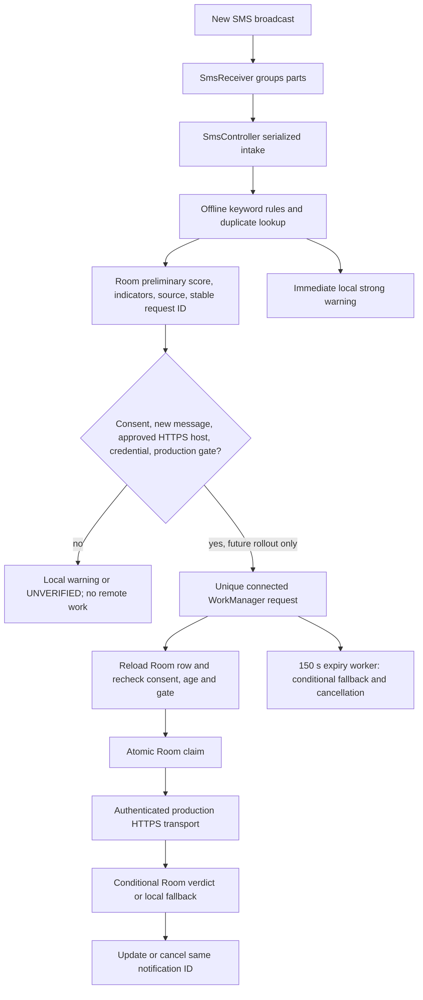

# Phase 3R: Automatic SMS detection integration

Prepared on 2026-10-28 using synthetic fixtures. **Automatic real SMS transmission remains disabled.** `RemoteTransportGate.PRODUCTION_READY` is `false`; no production listener, tunnel, database migration, or live SMS upload was started. The synthetic-only pilot screen and endpoint remain separate. Phase 3Q consent, credential quarantine, deletion, and HTTP cancellation changes were preserved.

## Changed files

| File | Change |
| --- | --- |
| `backend/remote/ProductionRemoteRuntime.kt` | Builds the production-only HTTPS origin and gate requirements from the approved host, current consent, and Keystore credential. The hostname is blank by default. The temporary Quick Tunnel is rejected. |
| `controller/SmsController.kt` | Serializes incoming intake across receiver instances, preserving existing keyword scoring and local alert behavior while preventing concurrent duplicate inserts. It checks the production gate for new-message eligibility. Pending failure/consent transitions now use conditional Room updates instead of read-then-overwrite. |
| `backend/database/dao/MessageDao.kt`, `backend/repository/MessageRepository.kt` | Queries queued rows for recovery and conditionally moves only queued/analyzing local rows to unavailable or consent-disabled. Completed remote verdicts cannot be overwritten by an expiry or failure worker. No schema or migration changed. |
| `backend/worker/SmsProcessingWorker.kt` | Connects Room → `AutomaticRemoteCoordinator` → `ProductionSmsTransport` behind repeated consent and `PRODUCTION_READY` checks. Uses unique per-message WorkManager requests, a connected-network constraint only when ready, one analysis attempt, a stable Room request ID, and an expiry worker after 150 seconds. The expiry worker sends no SMS. App startup recovers queued rows interrupted between Room insert and enqueue. |
| `backend/worker/AutomaticSmsWorkPolicy.kt` | Pure eligibility decision for queued, stale, restarted, consent-revoked, historical, and completed rows. A restarted analyzing worker falls back rather than repeating a possibly completed inference. |
| `backend/worker/AutomaticSmsWorkPolicyTest.kt` | Synthetic JVM tests for fresh consent, revocation, stale/restarted work, and historical/completed exclusion. |
| `androidTest/OfflineKeywordSmsTest.kt`, `androidTest/backend/remote/RemoteAnalysisDaoInstrumentedTest.kt` | Compiled device tests for concurrent duplicate intake, historical exclusion, queued recovery, atomic fallback, and preservation of completed verdicts. They were **not executed on a device** here. |
| `.gitignore` | Ignores Gradle/Kotlin's generated `.kotlin/` session directory. |

Existing `SmsReceiver`, `AutomaticRemoteCoordinator`, `RoomRemoteAnalysisStateStore`, `ProductionSmsTransport`, `NotificationHelper`, consent/credential stores, and backend routes are reused. Backend source files were not changed in Phase 3R. Earlier Phase 3Q working-tree changes remain intact.

## Detection architecture



The receiver still runs local keyword rules before considering any remote work. The score and matched indicator codes are saved with the message. A zero-score message remains `UNVERIFIED` until a valid remote SAFE verdict commits. Local strong warnings are immediate and remain visible when inference fails. Historical inbox sync sets `historicalImport=true` and cannot become `REMOTE_PENDING` or upload. The receiver does not read or send inbox history through the production worker.

A candidate reaches the worker only if it was new, consented, and gate-eligible at intake. The worker reloads that row, checks consent generation, age, state, configured HTTPS host, credential, and gate again. The coordinator atomically claims `AI_QUEUED → AI_ANALYZING`; a duplicate claim cannot issue another request. The production transport checks consent and endpoint again immediately before its HTTP call. The backend's stable idempotency key and encrypted replay protect an explicit duplicate request after a server restart. No automatic inference retry is performed; this is a bounded one-attempt policy.

WorkManager stores only the Room message ID. It requires network only for a gate-approved request. A separate unconstrained expiry request closes a pending or stalled row after 150 seconds and cancels the message work **only if** its conditional fallback update succeeded; it cannot cancel notification posting after a completed verdict. On app restart, recent `AI_QUEUED` rows are re-enqueued; stale queued/analyzing rows become unavailable. A restarted `AI_ANALYZING` worker does not repeat the model request. A permanently offline device can retain a WorkManager entry until the expiry worker runs; it will not transmit an expired message later.

A successful authenticated result commits through the existing conditional Room update. `SmsController` posts a remote SCAM/SUSPICIOUS alert only after that commit or cancels an earlier local alert for verified SAFE. Local and remote warnings use the same message ID; `NotificationHelper` sets `setOnlyAlertOnce(true)`. A failed, timed-out, malformed, canceled, or authentication-rejected analysis keeps the local warning or `UNVERIFIED`, never invents SAFE. Research contribution consent and storage are unchanged.

## Security gate and consent

`RemoteTransportGate.PRODUCTION_READY=false` is the final hard stop in this build. Intake and the worker short-circuit on that flag before reading a production credential or constructing a transport. The approved production hostname is blank by default, and the current Quick Tunnel is excluded. The production transport uses `/api/v1/sms/analyze` with an installation bearer credential; it never uses `/api/sms/analyze` or the synthetic pilot marker. Normal TLS verification and no redirects remain in place. The configured hostname check is a prerequisite, while actual TLS validation occurs during the request; it is not a substitute for physical-device review. No credential is embedded in the APK.

The Phase 3Q Settings opt-out is unchanged: consent is persisted off before network work, tagged analysis work is canceled, and pending Room rows are reconciled. A deletion request carries no SMS body. HTTP 401/403 quarantines a credential for analysis; only an authenticated backend 204 confirms deletion. Failed deletion stays visible and pending. The coordinator's generation checks prevent a verdict from being applied after consent revocation, and cancellation closes an in-flight OkHttp call when possible. Content already received by the backend cannot be recalled.

## Verification performed

- Android `./gradlew :app:testDebugUnitTest :app:assembleDebug :app:assembleDebugAndroidTest :app:compileReleaseKotlin --offline`: **124 JVM tests discovered, 119 passed, 0 failed, 5 staging-only skips**. Debug APK, instrumentation APK, and release Kotlin compilation passed.
- Backend `npm test`: **113 tests, 111 passed, 0 failed, 2 optional staging/PostgreSQL skips**. No model evaluation was run.
- Static review: `PRODUCTION_READY=false`; production worker references only `ProductionSmsTransport`; the synthetic pilot endpoint has no live receiver caller. `git diff --check` passed.
- No Android phone or ADB executable was available on this Mac. Instrumentation tests were compiled, **not executed**. No production endpoint was contacted.

The debug APK is `app/build/outputs/apk/debug/app-debug.apk`; the instrumentation APK is `app/build/outputs/apk/androidTest/debug/app-debug-androidTest.apk`. These local working-tree changes were not committed or pushed.

## Windows physical-device checklist

From `Mobile_App` in PowerShell with a working JDK/Android SDK and an authorized test phone:

```powershell
adb devices -l
.\gradlew.bat :app:testDebugUnitTest :app:assembleDebug :app:assembleDebugAndroidTest --console=plain
.\gradlew.bat :app:connectedDebugAndroidTest --console=plain
```

Confirm ADB says `device`. Inspect `app\build\reports\androidTests\connected\index.html`; distinguish passed, failed, and skipped tests. Enable OS notification permission, its channel, and ApCiDa scam alerts before the synthetic notification test. Check synthetic duplicate intake, zero-rule `UNVERIFIED`, high-risk local warning, historical exclusion, Room claim/completion, and notification same-ID update/cancellation. Perform a supervised synthetic process-kill/relaunch check because database reopen alone does not prove WorkManager recovery. Keep the production gate closed, do not provision a real production credential, and do not use real SMS for this check.

## Remaining activation blockers

1. Approve a stable protected HTTPS hostname and Cloudflare Access/device-auth design; validate TLS and server identity from a phone. The Mac must be awake and available.
2. Approve a separate production database/schema deployment, per-install credential provisioning/rotation, consent wording, sender/time minimization, backup/log retention, and administrator deletion when a token is expired or lost.
3. Execute physical instrumentation and supervised notification, offline-expiry, process-death, timeout, credential-rejection, and revocation races against synthetic fixtures. The current new device tests only compile here.
4. Review the Room-commit-to-notification crash window and the remaining small race after a request has already reached the server. Confirm the 90 s Node / 115 s Android / 125 s default proxy budget using a separately approved stable staging route.
5. Make a separate explicit activation decision before changing `PRODUCTION_READY` or configuring real credentials/hosting. Phase 3R does not authorize or perform that step.
